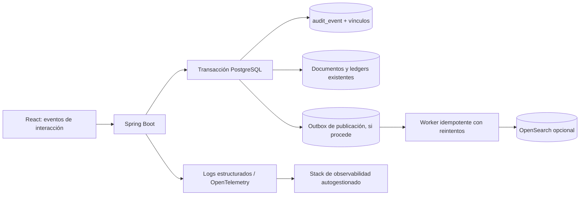

# Propuesta de mejora de base de datos y trazabilidad integral para Inventary

**Tipo:** propuesta técnica para auditoría interna, trazabilidad de clientes y productos, observabilidad y búsqueda sin suscripciones obligatorias.  
**Repositorio revisado:** [JhonnyMinian92/inventary](https://github.com/JhonnyMinian92/inventary) — rama `master`.  
**Fecha de análisis:** 2026-10-29.  
**Estado:** recomendación; no implementa cambios en el código ni en la base de datos.

---

## 1. Resumen ejecutivo

Inventary ya dispone de componentes que deben aprovecharse, no duplicarse: PostgreSQL como fuente transaccional, migraciones Flyway, una tabla `audit_event`, `AuditService`, el endpoint `GET /api/v1/audit-events`, un identificador de correlación `X-Request-ID`, movimientos de inventario históricos, ledger de valoración, Outbox y un inbox para deduplicación de Kafka.

Sin embargo, estos componentes **no equivalen todavía a una trazabilidad completa de todo el ciclo de vida**. En el código revisado:

- `audit_event` conserva actor, acción, tipo/ID de recurso, resultado, correlación, metadatos JSONB y fecha. Tiene índices por fecha, actor, recurso y acción.
- `AuditController` permite consultar eventos con filtros por actor, acción, recurso, resultado y rango de fechas; limita cada página a 100 resultados y requiere `audit:read`.
- `ApiRequestAuditFilter` registra principalmente respuestas HTTP fallidas (status HTTP 400 o superior). No convierte automáticamente cada petición exitosa ni cada clic de React en un evento de auditoría.
- Hay servicios de dominio que llaman a `AuditService`, pero la existencia de ese servicio no demuestra que cada cambio, consulta sensible y transición de todos los módulos esté instrumentada de manera uniforme.
- Las migraciones protegen movimientos de stock y entradas de valoración frente a modificaciones/eliminaciones directas. En las migraciones revisadas no se identificó una protección append-only equivalente específica para `audit_event`.
- El canal WhatsApp conserva carritos, cotizaciones y pedidos con `customerRef` y estados operativos, pero eso no es un registro integral de mensajes entrantes/salientes, estados de entrega/lectura o interacciones del usuario en el frontend.
- Las ventas enlazan con `business_partner`, mientras que WhatsApp utiliza una referencia externa `customerRef`: para una vista 360 del cliente hace falta un vínculo de identidad de canal controlado y verificable.
- El README del repositorio, la documentación de arquitectura y el directorio de migraciones no coinciden en la última versión de Flyway indicada. El directorio revisado contiene migraciones hasta `V18`, mientras algunos documentos citan `V14` o `V15`. Debe corregirse el inventario documental antes de diseñar la siguiente migración.

### Decisión recomendada

1. **Mantener PostgreSQL como fuente de verdad** para auditoría de negocio, relaciones, stock, ventas, compras, clientes, pedidos y trazabilidad legal/operativa.
2. Extender la auditoría existente con un contrato de eventos, vínculos entre entidades, reglas append-only, permisos estrictos, pruebas de cobertura y una correlación común.
3. Separar tres conjuntos de datos: **auditoría de negocio**, **telemetría de interacción de interfaz** y **logs/métricas/trazas técnicas**. Están relacionados, pero no son intercambiables.
4. Instrumentar los clics relevantes y, si se exige cobertura de cada clic dentro de la SPA, registrar también eventos de interacción de forma controlada. No capturar contraseñas, contenido de campos, pulsaciones de teclas ni datos sensibles indiscriminadamente.
5. Añadir un modelo explícito de eventos de comunicación y entrega para los canales que realmente los proporcionen. No inferir que un cliente “dejó de escribir” si el canal no entrega eventos verificables.
6. Para empezar sin suscripciones, usar PostgreSQL con índices adecuados y búsqueda de texto completo. Si el volumen y la necesidad de búsqueda distribuida lo justifican, incorporar **OpenSearch autogestionado**, licenciado Apache 2.0, como índice derivado. No construir un motor de búsqueda propio comparable a Elasticsearch.
7. Establecer respaldos verificables, recuperación a un punto en el tiempo, archivo inmutable fuera de la base principal, alertas de fallos de auditoría y pruebas de restauración. No prometer “cero pérdida” sin objetivos medibles, infraestructura redundante y pruebas.

## 2. Alcance y definición de trazabilidad

La trazabilidad debe responder, con autorización y evidencias:

- **Producto:** quién lo creó o editó; cambios de SKU, nombre, categoría, unidad, precio, atributos o estado; cuándo y dónde entró al inventario; lote/documento de origen si existe; recepciones, ajustes, conteos, traslados, reservas, ventas, devoluciones, mermas y valoración; usuarios que realizaron/aprobaron operaciones; y correcciones compensatorias.
- **Cliente:** cómo se identificó y por qué canal; consentimientos y preferencias; interacciones relevantes; consultas, carrito, cotización, pedido, compra, método/referencia de pago permitida, despacho/entrega, devoluciones, reclamos y comunicaciones; fechas de último contacto y última compra; y cambios del perfil.
- **Usuario interno o integración:** autenticaciones, cambios de permisos, lectura/exportación de datos protegidos, operaciones intentadas y ejecutadas, resultados, aprobaciones, fallos, reintentos e identidad técnica que produjo el evento.
- **Proceso técnico:** petición HTTP, identificador de petición, traza distribuida cuando aplique, latencia, error, dependencia afectada y resultado de la entrega de eventos a índices externos.
- **Interfaz:** navegación, clic en controles identificables, filtros, envío de formulario, validación fallida, avance/abandono de pasos y comienzo/fin de una acción; esto describe interacción, **no prueba por sí solo que una operación de negocio se haya completado**.

### Lo que significa “no perder datos”

Ningún diseño puede garantizar pérdida absolutamente imposible ante todos los escenarios: corrupción del medio, pérdida simultánea de réplicas, errores humanos, credenciales privilegiadas comprometidas, proveedor de canal que no entregue un webhook o navegador desconectado son riesgos reales. La meta verificable debe ser:

- Las acciones de negocio críticas no se confirman si no se guardan, en la misma transacción, el cambio de negocio y su evento de auditoría.
- Los eventos externos se reciben con idempotencia y quedan persistidos antes de procesarse.
- Los fallos de ingestión, publicación e indexación se reintentan, alertan y se pueden reconciliar.
- Los datos críticos se respaldan y restauran conforme a RPO/RTO acordados.
- Las acciones privilegiadas dejan evidencia fuera del alcance ordinario de quien administra la aplicación.
- La telemetría del navegador se declara como tal: puede necesitar reintentos y cola local, pero no debe presentarse como evidencia transaccional infalible.

## 3. Arquitectura actual verificada y brechas

### Componentes que ya existen

| Componente | Estado observado | Uso propuesto |
|---|---|---|
| PostgreSQL + Flyway | Fuente transaccional y esquema versionado | Conservar como fuente de verdad; añadir migraciones incrementales sin reescribir las ya aplicadas. |
| `audit_event` | Evento con `actor`, `action`, `resource_type`, `resource_id`, `outcome`, `correlation_id`, `metadata JSONB`, `occurred_at` | Extender contrato, vínculos de entidades, retención y protección contra alteraciones. |
| `AuditService` | Guarda eventos de éxito y resultados de acceso/autenticación en determinados flujos | Unificar catálogo de eventos, clasificación y política de errores; añadir pruebas de cobertura. |
| `GET /api/v1/audit-events` | Consulta protegida, filtros exactos, máximo 100 por página | Mantener compatibilidad; agregar filtros de producto/cliente/sesión, búsquedas y exportación controlada. |
| `RequestCorrelationFilter` | Genera/valida `X-Request-ID` y lo agrega al MDC | Extender correlación entre UI, API, jobs, Outbox, webhooks e índice externo. |
| `ApiRequestAuditFilter` | Registra peticiones API fallidas sin leer cuerpos ni cabeceras sensibles | Añadir acceso HTTP estructurado y auditar lecturas sensibles; mantener la regla de no capturar secretos. |
| `stock_movement` y `inventory_valuation_entry` | Ledger con protección append-only descrita en migraciones/documentación | Usar estos ledgers como verdad de movimientos y valoración; nunca sustituirlos por logs. |
| Outbox e inbox Kafka | Existen; Kafka está deshabilitado por defecto y el consumidor descrito invalida caché pública | Reutilizar el patrón de entrega fiable, pero no hacer depender la auditoría del broker. |
| WhatsApp | Carrito, cotización, pedido, referencia externa y estados comerciales | Añadir eventos del proveedor de mensajería y entrega si el flujo de integración los soporta. |
| Frontend React/Vite | SPA que consume REST | Añadir catálogo de eventos de interfaz y correlación con el resultado final de la API. |

### Brechas que deben cerrarse

1. No existe un contrato uniforme que obligue a todos los comandos a emitir un evento con esquema y resultado normalizados.
2. La auditoría de errores HTTP no cubre por sí sola acciones exitosas, lecturas sensibles, clics ni toda la vida de una conversación.
3. La tabla de auditoría actual no representa de forma relacional múltiples entidades afectadas en un solo evento (por ejemplo, una venta que consume varios productos y pertenece a un cliente).
4. No se debe depender únicamente de que cada servicio recuerde llamar manualmente a `AuditService`; el cumplimiento se debe verificar mediante pruebas y una matriz de eventos esperados por transición.
5. Se debe comprobar, en una nueva migración y tests de PostgreSQL, que `audit_event` no admite `UPDATE`/`DELETE` desde el rol de aplicación y que los roles de ejecución no tienen permisos DDL.
6. La identidad de WhatsApp debe vincularse al cliente canónico con una asociación verificable, sin convertir un `customerRef` autodeclarado en identidad suficiente.
7. Los eventos de mensajería y estados de entrega dependen del proveedor/conector real. Si n8n o el proveedor externo no reenvían un evento al backend, Inventary no puede registrarlo retroactivamente.
8. La trazabilidad de envío/entrega física requiere un dominio de logística con eventos, estados, responsable, transportista, prueba de entrega y marca temporal, si esa funcionalidad no está implementada ya en el entorno desplegado.
9. Debe corregirse la documentación de versiones de Flyway: el árbol inspeccionado incluye `V1`–`V18`, aunque algunos documentos citan límites anteriores. Antes de escribir SQL definitivo, comparar el esquema y el historial Flyway del entorno real.

## 4. Modelo de datos recomendado

La solución debe ser incremental. No borrar ni sustituir los ledgers existentes. Los nombres siguientes son propuestas de diseño; las columnas y restricciones finales deben ajustarse al esquema real y a las migraciones ya aplicadas.

### 4.1 `audit_event`: registro canónico de negocio y seguridad

Mantener la tabla existente y ampliar su contrato mediante una migración nueva. Como mínimo cada evento debería identificar:

| Campo lógico | Propósito |
|---|---|
| `id` | ID único del evento (UUID). |
| `occurred_at` | Momento declarado por el componente que originó el hecho, siempre UTC. |
| `recorded_at` | Momento en que PostgreSQL recibió/persistió el evento. Permite detectar retraso y eventos tardíos. |
| `actor_type`, `actor_id` | Persona interna, cliente autenticado, integración, job del sistema o usuario anónimo; el ID debe ser estable y no un nombre mutable. |
| `actor` | Conservar temporalmente el campo legado para compatibilidad y consultas actuales. |
| `action` | Acción enumerada y estable, por ejemplo `PRODUCT_UPDATED`, `SALE_POSTED`, `STOCK_ADJUSTMENT_POSTED`, `CUSTOMER_MESSAGE_RECEIVED`. |
| `resource_type`, `resource_id` | Recurso principal afectado; conservar compatibilidad con la tabla existente. |
| `outcome` | `SUCCESS`, `DENIED`, `FAILURE` y, si se aprueba, `PENDING` para procesos realmente asíncronos. No convertir un evento pendiente en éxito antes de finalizarlo. |
| `channel` | `WEB`, `POS`, `WHATSAPP`, `API`, `JOB`, `ADMIN` u otro canal real definido. |
| `request_id`, `correlation_id`, `causation_id` | Unir petición HTTP, interacción, evento padre y tarea asíncrona. `request_id` identifica la petición; `correlation_id` el flujo; `causation_id` la causa directa. |
| `event_version` | Versión del esquema del evento para evolucionar sin romper consumidores. |
| `metadata` | JSONB con datos no sensibles, estructurados y validados por evento. No guardar objetos completos indiscriminadamente. |
| `change_set` | Diferencias de campos permitidos (`campo`, operación, valor anterior/nuevo redacted o cifrado). No almacenar secretos ni repetir datos personales sin finalidad. |
| `integrity_hash` / `previous_hash` | Opcional para detección de alteraciones, con checkpoints firmados externos; no confiar en hashes almacenados solo en la misma BD como única defensa. |

No es necesario replicar en cada evento todos los datos de la entidad. El evento debe conservar los identificadores y snapshots mínimos necesarios para reconstruir el contexto histórico; los documentos transaccionales y ledgers siguen siendo las fuentes de la verdad comercial.

### 4.2 `audit_event_link`: relación de un evento con varias entidades

Crear una tabla que permita encontrar eventos a partir de producto, cliente, venta, recepción, devolución, almacén, pedido, cotización, promoción o usuario.

Campos recomendados:

- `audit_event_id` — FK a `audit_event(id)` con `ON DELETE RESTRICT`.
- `entity_type` — tipo de entidad de un catálogo cerrado.
- `entity_id` — UUID de la entidad relacionada.
- `relation_role` — `PRIMARY`, `CUSTOMER`, `PRODUCT`, `SALE_LINE`, `SOURCE`, `DESTINATION`, `APPROVER`, etc.

Índice inicial: `(entity_type, entity_id, audit_event_id)`. Si se requieren claves foráneas estrictas por entidad, usar tablas puente específicas para las relaciones críticas; una columna polimórfica `entity_type/entity_id` por sí sola no tiene FK a todas las tablas.

Esto resuelve el caso de una venta de varios productos: un mismo evento de negocio enlaza la venta, el cliente y todas las líneas/productos afectados sin copiar ni multiplicar el contenido del evento.

### 4.3 `ui_interaction_event`: telemetría de interfaz

Debe mantenerse separada de la bitácora de negocio para que miles de clics no se confundan con operaciones contabilizadas.

Campos sugeridos:

- `id`, `received_at`, `client_occurred_at`.
- `actor_id` cuando hay sesión, o identificador seudónimo de sesión anónima permitido por la política de privacidad.
- `session_key_hash`, `request_id` y `correlation_id`.
- `event_name`, por ejemplo `UI_CLICK`, `ROUTE_OPENED`, `FORM_SUBMITTED`, `VALIDATION_FAILED`, `STEP_ABANDONED`, `FILTER_CHANGED`, `EXPORT_REQUESTED`.
- `route_template`, `component_id` y `action_id` de catálogo. No registrar URLs completas con identificadores o texto libre cuando una plantilla de ruta es suficiente.
- `entity_type/entity_id` opcional si el usuario estaba trabajando sobre una entidad conocida.
- `properties` JSONB con lista permitida, sin valores de entrada sensibles.

**Regla de captura:** se puede registrar todo clic dentro de los controles instrumentados de la SPA, incluyendo identificador del control, ruta, sesión y fecha. No se deben registrar pulsaciones de teclas, contenido de contraseñas, tokens, datos de tarjeta, texto introducido en formularios, portapapeles ni contenido de mensajes como si fueran simples eventos de UI. Para campos largos se pueden registrar `field_id`, resultado de validación y tipo de error, nunca el valor.

Para evitar pérdida accidental de telemetría: enviar lotes pequeños con reintento y acuse del servidor; usar `sendBeacon` cuando sea apropiado para el cierre/navegación; aplicar una cola temporal en el cliente solo para eventos de UI permitidos; y deduplicar por ID de evento. Los eventos del navegador deben etiquetarse como telemetría y no como prueba transaccional.

### 4.4 Identidad de cliente por canal

Crear una tabla de asociación como `customer_channel_identity` que vincule el cliente canónico de Inventary con una identidad externa verificada.

Campos conceptuales: `id`, `customer_id`/`business_partner_id`, `channel`, `provider_account_id`, `external_subject_hash`, `external_subject_encrypted` solo si es imprescindible, `verified_at`, `consent_reference`, `status`, `created_at`, `updated_at`.

- Un mismo cliente puede tener varias identidades de canal.
- La identidad externa debe derivarse del proveedor/canal autenticado, no del texto escrito por un bot o un modelo de lenguaje.
- Evitar mostrar números de teléfono, correos y documentos fiscales en los índices de búsqueda de auditoría cuando un ID interno basta.
- Los cambios y desvinculaciones de identidad deben generar eventos de auditoría.

### 4.5 Eventos de mensajes y estado de entrega

Crear un registro normalizado de eventos de canal (por ejemplo `customer_communication_event`) si la integración realmente recibe webhooks del proveedor. Debe cubrir, cuando el proveedor los entregue:

- Mensaje entrante recibido y su ID externo.
- Mensaje saliente solicitado y enviado.
- Estado de entrega, lectura, fallo o rechazo.
- Canal, identidad asociada, fecha del proveedor y fecha de recepción por Inventary.
- Correlación con carrito, cotización, pedido, venta o caso de soporte.
- Hash/digest del payload para idempotencia y diagnósticos.

Usar una clave única compuesta por proveedor/cuenta/ID externo del evento para que los webhooks repetidos no creen duplicados. Guardar el evento de webhook antes de procesarlo; procesarlo después mediante trabajo idempotente.

El **contenido de mensajes** debe estar separado de sus metadatos. Conservar texto solo si existe finalidad, base legal y política de retención aprobadas; aplicar cifrado, permisos separados y registros de acceso. Para la mayoría de análisis de actividad bastan el tipo de evento, marcas de tiempo, estado, canal y referencias. Si el proveedor no envía confirmaciones de lectura/entrega, la aplicación no puede inventarlas.

### 4.6 Trazabilidad de entrega física y postventa

Si Inventary debe conocer “cuándo y cómo recibe” el cliente, debe persistir los hitos del proceso de cumplimiento, no solo marcar una venta como completada. Modelar, según el alcance comercial:

- `fulfillment`/`shipment`, `shipment_event` o entidades equivalentes.
- Venta/pedido y líneas que se despachan; cantidades y productos reales.
- Método: retiro en local, mensajería, transportista o entrega propia.
- Fecha de preparación, despacho, intento fallido, entrega y recepción confirmada.
- Responsable, transportista, referencia de guía y costo cuando aplique.
- Evidencia de entrega con acceso restringido (por ejemplo, ID de comprobante, firma o imagen referenciada de forma segura); no incrustar datos privados en logs técnicos.
- Motivo de incidencia, rechazo, devolución y estado postventa.

La historia del producto debe enlazar las salidas/entradas con `stock_movement`, líneas de venta/recepción/devolución y documentos de origen. La historia del cliente enlaza los hitos logísticos con la venta/pedido correspondiente.

### 4.7 Eventos derivados y señales de inactividad

No almacenar como hecho confirmado algo que solo es una inferencia. Se puede calcular una proyección con:

- `last_inbound_at`, `last_outbound_at`, `last_interaction_at`, `last_purchase_at`.
- `days_since_last_contact`, `days_since_last_purchase`.
- Regla de inactividad versionada, por ejemplo “sin mensaje entrante durante N días”, con zona horaria y canal explícitos.

Estos indicadores deben derivarse de eventos conservados y actualizarse de forma reproducible. Un evento `CUSTOMER_INACTIVE_THRESHOLD_REACHED` significa que se alcanzó una regla de inactividad, **no** demuestra que el cliente haya abandonado definitivamente la relación comercial.

## 5. Reglas de escritura y consistencia

### 5.1 Operaciones de negocio críticas

En una sola transacción PostgreSQL deben guardarse:

1. El cambio de negocio/documento.
2. Los movimientos o asientos ledger correspondientes.
3. El evento de auditoría de éxito y sus vínculos.
4. El evento Outbox de dominio, cuando el flujo necesite publicar el hecho fuera de la base.

Si el evento de auditoría requerido no puede persistirse, la operación crítica debe abortar. Así se evita una venta, recepción o ajuste sin evidencia correlacionada. El Outbox se publica después del commit y cualquier consumidor debe tolerar entrega al menos una vez e idempotencia.

Para errores de autenticación, autorización o una operación denegada que no tenga una transacción de negocio, se puede persistir el evento en una transacción independiente. Los fallos de la propia auditoría deben emitir una alerta operacional fuera del mismo camino que falló.

### 5.2 Acciones sin cambios de negocio

- Un clic y una apertura de pantalla generan telemetría de UI, no un evento de venta.
- Lecturas de información pública pueden quedar en logs de acceso agregados; el acceso a información sensible, su descarga y exportación deben producir un evento de seguridad auditable.
- Un formulario inválido registra el código/tipo de validación sin copiar el campo sensible.
- Una petición repetida con la misma `Idempotency-Key` no debe duplicar una venta, pago o movimiento. El intento repetido puede producir un evento técnico de replay enlazado al comando original.
- Las cancelaciones, correcciones o reversos de operaciones contabilizadas deben ser nuevos eventos y movimientos compensatorios, nunca eliminación del historial.

### 5.3 Inmutabilidad y roles de base de datos

Agregar, mediante una migración nueva:

- Un rol dueño de esquema/DDL distinto del rol de ejecución de la API.
- Un rol de aplicación que no tenga `UPDATE`, `DELETE`, `TRUNCATE`, creación de triggers ni permisos DDL sobre `audit_event` y ledgers.
- Un trigger que rechace `UPDATE` y `DELETE` de `audit_event` para las rutas ordinarias de administración.
- `ON DELETE RESTRICT` en las relaciones críticas de auditoría y documentos de negocio.
- Pruebas SQL contra PostgreSQL real que demuestren que la cuenta runtime no puede alterar/eliminar los eventos ni los ledgers.
- Un proceso de archivo/retención separado, con permisos restringidos y evidencia de autorización. La inmutabilidad no debe convertirse en una excusa para retener datos personales para siempre: aplicar reglas aprobadas de conservación, anonimización o supresión legal cuando proceda.

El trigger no es suficiente por sí solo: el dueño de la base puede cambiarlo. Para detectar manipulación administrativa, exportar checkpoints de integridad firmados o digests periódicos a almacenamiento separado de solo anexado/WORM con credenciales independientes. Los hashes deben verificarse en una tarea automática y generar alertas al fallar.

### 5.4 Datos personales y secretos

Está prohibido guardar en auditoría/logs:

- Contraseñas, tokens JWT, claves de integración, cookies de sesión o cabeceras `Authorization`.
- Credenciales de pago, números completos de tarjetas o códigos de autenticación.
- Payloads completos de peticiones por defecto.
- Texto de clientes, datos fiscales, teléfonos, correo, direcciones o documentos personales si no son necesarios para el propósito de auditoría.

Para cambios del perfil se puede guardar el nombre del campo modificado y una versión redacted. Cuando el valor anterior/nuevo sea imprescindible como evidencia, moverlo a un payload restringido/cifrado, auditar cada lectura y definir su retención. La implementación debe validarse con las obligaciones de privacidad y protección de datos aplicables en Ecuador, el propósito informado al usuario y los contratos de los proveedores de mensajería.

## 6. Índices, consulta y crecimiento

### 6.1 Índices iniciales

Ya existen índices por fecha, actor, recurso y acción. Mantenerlos tras medir el uso y añadir solo los que apoyen consultas reales, por ejemplo:

- Auditoría reciente: `(occurred_at DESC)`.
- Actor y periodo: `(actor, occurred_at DESC)` o ID estable de actor si se agrega.
- Acción y periodo: `(action, occurred_at DESC)`.
- Recurso primario: `(resource_type, resource_id, occurred_at DESC)`.
- Resultado y periodo si se necesita triage: `(outcome, occurred_at DESC)`.
- Correlación: índice de `correlation_id`/`request_id`.
- Cliente/producto: índice en `audit_event_link(entity_type, entity_id, audit_event_id)` y join con `audit_event` para ordenar cronológicamente.
- JSONB: índice GIN solo para campos/consultas identificados; no indexar todo JSON por defecto.

Las consultas de auditoría deberán usar límites de rango de fecha, paginación por cursor cuando el volumen crezca, y filtros por entidad/actor. Registrar y auditar exportaciones, así como consultas de alto riesgo.

### 6.2 Particionamiento

No particionar automáticamente `audit_event` desde el día uno. La tabla actual usa `id` como PK UUID; PostgreSQL impone restricciones específicas para las claves únicas de tablas particionadas por fecha: la clave única/primaria debe incluir la columna de particionamiento. Migrar una tabla existente a particiones mensuales exige diseñar la PK/índices, las consultas por ID y el archivado con cuidado.

Primero medir filas/día, tamaño de índices, latencia P95, retención y coste de backups. Si el volumen lo requiere, evaluar:

- particiones mensuales para `ui_interaction_event`, eventos de canal y logs archivables;
- rediseño explícito de PK/índices para particionar la auditoría de negocio;
- archivado por periodo y limpieza según política, con pruebas de integridad y restauración.

No usar una regla genérica que elimine eventos por antigüedad sin la matriz de retención aprobada.

## 7. Estrategia de búsqueda y observabilidad sin suscripción

### 7.1 Recomendación por etapas

**Etapa inicial: PostgreSQL solamente.** No hace falta incorporar Elastic u otro motor de búsqueda antes de medir el volumen. PostgreSQL ya guarda el evento relacional; JSONB, índices B-tree, búsqueda de texto completo y la extensión `pg_trgm` pueden cubrir filtros, búsquedas parciales y similitud textual en un volumen moderado. Referencia oficial de `pg_trgm`: https://www.postgresql.org/docs/16/pgtrgm.html.

**Etapa de crecimiento: OpenSearch autogestionado, si se justifica.** OpenSearch ofrece búsqueda y analítica de documentos, búsqueda de logs y visualización bajo licencia Apache 2.0 según el proyecto oficial: https://opensearch.org/ y https://github.com/opensearch-project/OpenSearch. Se puede alojar en infraestructura propia sin suscripción obligatoria al proyecto, aunque sí requiere máquinas, almacenamiento, actualizaciones, seguridad, copias y personal que lo opere.

**Observabilidad técnica:** mantener logs estructurados a stdout y exportarlos mediante OpenTelemetry Collector a un stack autogestionado de logs/métricas/trazas (por ejemplo, OpenSearch Dashboards para búsqueda de logs, o Grafana + Loki + Prometheus para observabilidad). Los productos y sus licencias/configuraciones deben revisarse al fijar versiones. No convertir esta plataforma en la única copia de auditoría de negocio.

### 7.2 ¿Elastic requiere pagar?

No es correcto afirmar que todo uso de Elastic requiere una suscripción: Elastic publica un nivel **Basic gratuito** para su despliegue autogestionado. Sin embargo, su página oficial distingue funcionalidades avanzadas y soporte asociado a planes de pago; por ejemplo, determinadas capacidades de seguridad/auditoría y controles avanzados aparecen en niveles superiores. Revisar la matriz vigente antes de depender de una función específica: https://www.elastic.co/subscriptions y https://www.elastic.co/pricing/self-managed.

Para este requisito de no depender de una suscripción, la recomendación es **PostgreSQL como registro canónico y OpenSearch autogestionado como índice opcional**, no comprometer el diseño a una función de Elastic de pago.

### 7.3 No construir un “Elastic casero”

No recomiendo crear un backend propio que pretenda reemplazar las capacidades internas de Elasticsearch/OpenSearch. Un motor de ese tipo debe resolver índice invertido, análisis lingüístico, ranking, paginación profunda, compactación de segmentos, sharding, replicación, fallos de nodo, consultas concurrentes, recuperación, seguridad y evolución de índices. Construirlo incrementaría el riesgo y el coste de mantenimiento.

Sí tiene sentido desarrollar dentro de Spring Boot un **módulo de trazabilidad y consulta de negocio** (por ejemplo, `AuditTrailService` y un puerto `AuditSearchPort`) que:

- consulte primero la fuente PostgreSQL;
- ofrezca endpoints autorizados y filtros del dominio Inventary;
- pueda usar PostgreSQL inicialmente y un adaptador OpenSearch más adelante;
- reconstruya/reindexe OpenSearch desde PostgreSQL sin perder la fuente original;
- no almacene reglas ni operaciones de negocio exclusivamente en el índice externo.

### 7.4 Flujo para indexar sin pérdida de la fuente

PostgreSQL confirma la verdad de negocio; la búsqueda externa puede retrasarse temporalmente. Deben existir estado de reintentos, DLQ o bandeja de fallos, métrica de retraso, redrive autorizado y una rutina de reconciliación. Un error de indexación no debe borrar ni revertir la transacción de negocio ya confirmada.

## 8. Trazabilidad de producto y cliente

### 8.1 Vista “Historia completa del producto”

Construir una consulta de aplicación que agregue, cronológicamente y con paginación:

1. Alta y modificaciones de catálogo, atributos, unidades, SKU/barcode, categoría, imágenes y estado.
2. Cambios de precio y reglas de promoción, con valores anteriores/nuevos protegidos y vigencia.
3. Órdenes de compra, proveedor, aprobaciones, recepciones parciales y devoluciones a proveedor.
4. Todos los movimientos de stock con origen, destino, almacén/ubicación, cantidad, unidad, motivo, usuario y documento que los originó.
5. Conteos, ajustes, transferencias, reservas y liberaciones.
6. Líneas de venta, canal, cliente, cantidad, snapshot comercial, salida de stock y valoración histórica.
7. Devolución de cliente, RESTOCK/SCRAP, compensaciones, incidencias de garantía/servicio y logística cuando existan.
8. Acciones de consulta, exportación o modificación sensible relacionadas con el producto.

La fuente cuantitativa para el saldo histórico sigue siendo el ledger de inventario, no la suma ciega de eventos UI. Las operaciones que afecten varios productos deben enlazar todos los IDs de producto al evento/documento correspondiente.

### 8.2 Vista “Historia completa del cliente”

Unificar la identidad canónica y mostrar una cronología autorizada con:

1. Alta del cliente y cambios del perfil; quién los hizo y cuándo.
2. Canal e identidad verificada; consentimiento y preferencias relevantes.
3. Mensajes entrantes/salientes y estado entregado/leído/fallido solo donde el proveedor lo comunique.
4. Eventos de navegación/consulta/clic permitidos, cuando exista una sesión identificable y una base válida para asociarlos.
5. Carritos, productos vistos/seleccionados, cotizaciones, expiraciones, pedidos y cambios de estado.
6. Compras reales: productos, cantidades, precio/discount snapshot permitido, fecha, almacén, canal y venta asociada.
7. Confirmación de pago por el personal o proveedor real, con método y referencia limitada; nunca guardar credenciales de pago.
8. Despacho, retiro, entrega confirmada, incidencias, devolución, reclamo y actividad postventa.
9. Último contacto, última compra, inactividad por umbral y resultados de campañas, manteniendo separado dato observado de inferencia.

Las consultas y exportaciones de esta vista deben tener permiso específico, límites de rango y auditoría del propio acceso. El rol de auditoría no debe ganar automáticamente permiso para editar clientes, pedidos o ventas.

## 9. API y permisos propuestos

Mantener las APIs actuales y añadir funcionalidad de forma compatible. Nombres ilustrativos:

- `GET /api/v1/audit-events` — ampliar filtros compatibles y añadir paginación por cursor cuando corresponda.
- `GET /api/v1/audit-trails/products/{productId}` — cronología combinada de documentos, movimientos y auditoría del producto.
- `GET /api/v1/audit-trails/customers/{customerId}` — cronología autorizada del cliente.
- `POST /api/v1/telemetry/ui-events` — recepción autenticada/limitada de lotes de eventos de interfaz con validación de esquema e idempotencia.
- Webhooks de canal — rutas dedicadas por proveedor, con firma/verificación, timestamp, tolerancia a replay, ID externo único y persistencia antes de procesar.
- Endpoints de integridad/exportación — solo para roles autorizados, con registro de quién consultó, verificó o exportó datos.

Permisos sugeridos (los nombres finales deben seguir el catálogo RBAC real):

- `audit:read`: metadatos de auditoría ordinaria.
- `audit:sensitive:read`: valores anteriores/nuevos o payloads privados cuando sean necesarios.
- `audit:export`: exportación con límites y formato permitido.
- `audit:integrity:verify`: ejecutar/ver resultados de verificaciones de integridad.
- `telemetry:read`: acceso a eventos de interfaz cuando no contengan datos sensibles.
- `operations:manage`: redrive de eventos fallidos, limitado y auditado.

Además, auditar las lecturas sensibles, descargas y exportaciones de la propia bitácora. Evitar consultas globales sin rango de fecha, límites de exportación y controles contra enumeración de datos.

## 10. Retención, recuperación y continuidad

Definir una matriz aprobada de retención por tipo de dato; no asumir que todos los datos deben guardarse indefinidamente.

| Familia | Retención/política requerida |
|---|---|
| Documentos comerciales y ledgers | Según obligaciones contables/comerciales y política interna aplicable; no eliminarlos para corregir una operación. |
| Eventos de auditoría de negocio/seguridad | Retención aprobada por cumplimiento; append-only en operación normal, archivo verificable y acceso restringido. |
| Mensajes y datos personales | Finalidad específica, mínimos necesarios, cifrado, permisos separados, gestión de derechos y eliminación/anonimización cuando proceda legalmente. |
| Telemetría de clics | Retención más corta y configurable; usar agregación/análisis cuando no haga falta conservar el evento granular. |
| Logs técnicos y trazas | Retención operativa según la necesidad de diagnóstico; redacción y rotación, sin secretos. |
| Índice OpenSearch | Reproducible a partir de la fuente; su retención no debe ser la única política de conservación. |

Controles de continuidad:

- Backups base de PostgreSQL y archivado continuo de WAL para recuperación a un instante (PITR), si el entorno lo soporta.
- Al menos una copia en un dominio de fallo distinto y almacenamiento de respaldo con credenciales separadas.
- Pruebas programadas de restauración en un entorno aislado; un backup que nunca se restaura no está verificado.
- Definir y medir RPO (pérdida máxima de datos aceptable) y RTO (tiempo de recuperación aceptable) según el negocio.
- Alertas ante fallo de backup, retraso de WAL, disco próximo a llenarse, crecimiento anómalo de eventos, errores al persistir auditoría, retraso del Outbox, backlog de webhooks, fallos de indexación y verificación de hashes.
- Procedimiento documentado para incidente de seguridad, restauración, reconciliación de movimientos y reindexación.
- Proteger las copias: los datos de auditoría pueden ser tan sensibles como los datos operacionales.

## 11. Plan de implementación sugerido

### Fase 0 — inventario y línea base

- Confirmar el SHA desplegado y el historial `flyway_schema_history` en la base objetivo.
- Resolver la discrepancia documental `V1`–`V18` y listar todas las entidades/operaciones efectivas.
- Construir una matriz `módulo → comando/transición → evento esperado → tabla/documento → prueba`.
- Medir eventos por día, tamaño de las tablas, tamaño de índices, latencia de consulta y carga de peticiones.
- No alterar ni renombrar migraciones aplicadas.

### Fase 1 — endurecer la auditoría existente

- Crear una nueva migración Flyway para los campos y tabla de vínculos necesarios.
- Definir un catálogo estable de nombres de eventos y metadatos permitidos por tipo.
- Asegurar evento de éxito atómico con cada transición crítica; registrar las denegaciones y fallos en transacción separada cuando corresponda.
- Restringir permisos de BD y añadir protección append-only a `audit_event`.
- Registrar lectura/descarga/exportación de información sensible.
- Crear pruebas de integración con PostgreSQL para rollback, concurrencia, idempotencia, redacción y permisos.

### Fase 2 — cobertura completa por dominio

- Catálogo y productos.
- Compras, aprobación, recepción y devolución a proveedor.
- Saldos, ajustes, conteos, traslados, reservas y valoración.
- Ventas, líneas, cancelaciones aprobadas, devoluciones y coste histórico.
- Clientes/proveedores, usuarios, roles, permisos y configuración.
- Carritos, cotizaciones, pedidos, pagos confirmados manualmente y suscripciones, si están dentro del alcance desplegado.
- Cada endpoint crítico debe tener prueba que compruebe tanto el efecto comercial como el evento persistido, sin duplicados en reintentos.

### Fase 3 — trazabilidad de cliente/canal

- Crear la asociación canónica entre cliente de Inventary e identidad externa verificada.
- Recibir y persistir los webhooks disponibles de mensajes/entrega con firma, idempotencia y protección contra replay.
- Registrar el vínculo entre mensajes, carritos, cotizaciones, pedido y venta.
- Añadir el dominio de logística y prueba de entrega si lo exige el negocio y no existe ya en el entorno real.
- Separar metadatos de mensajes de su contenido y aplicar permisos/retención.

### Fase 4 — instrumentación de la SPA

- Crear una biblioteca común de eventos React con nombres y propiedades permitidas.
- Instrumentar clics, navegación, paso de formularios, validaciones, exportaciones y cambios de filtros con un identificador estable del control.
- Asociar `session_key`, `request_id`/`correlation_id` y el resultado de la operación del servidor cuando exista.
- Capturar datos únicamente dentro de Inventary y excluir inputs/elementos privados por defecto.
- Añadir pruebas que simulen pérdida de red, reintentos y deduplicación.

### Fase 5 — consulta, búsqueda y observabilidad

- Entregar una búsqueda inicial basada en PostgreSQL e índices medidos.
- Probar consultas de historia de cliente/producto con volúmenes representativos.
- Si las mediciones justifican una herramienta externa, desplegar OpenSearch en una red privada, con TLS, roles, snapshots, límites de recursos y actualización controlada.
- Exportar eventos a OpenSearch mediante una cola/outbox idempotente; probar recuperación y reconstrucción total del índice desde PostgreSQL.
- Añadir dashboards/alertas, archivos de evidencia y verificación periódica de integridad.

### Fase 6 — operación y validación final

- Ensayar restauración de backup y recuperación PITR.
- Ensayar indisponibilidad temporal de OpenSearch, Kafka, colector de logs y proveedor de mensajes.
- Demostrar que la operación comercial puede mantener la auditoría canónica aunque el índice externo esté caído; para acciones críticas no se debe permitir el commit sin el evento de auditoría.
- Publicar runbook, matriz de retención, responsables, permisos y procedimiento de incidente.

## 12. Definition of Done / criterios de aceptación

La solución no debe declararse finalizada hasta demostrar en CI o pruebas reproducibles:

1. **Cobertura:** cada transición de negocio crítica enumerada tiene un evento de auditoría y pruebas positivas y negativas.
2. **Atomicidad:** si se revierte una venta, recepción o ajuste, no queda un evento de éxito huérfano; si falta el evento obligatorio, se revierte la operación crítica.
3. **Idempotencia:** reintentos y webhooks duplicados no duplican ventas, movimientos ni eventos de proveedor; quedan diagnosticados por la clave del evento original.
4. **Trazabilidad del producto:** dado un ID de producto, se puede reconstruir una cronología y enlazar cada variación de stock con un movimiento/documento original, devolución o compensación.
5. **Trazabilidad del cliente:** dado un cliente canónico, se consultan compras y canales vinculados, cotizaciones/pedidos, comunicaciones disponibles y hitos de entrega, sin exponer datos fuera de permisos.
6. **Clics de interfaz:** los controles definidos producen telemetría estable; cada evento enlazable se relaciona con la petición/resultante del servidor; los campos sensibles no se capturan.
7. **Seguridad:** rol sin permisos no puede leer la bitácora ni payloads sensibles; el rol de runtime no puede editar/eliminar registros de auditoría ni ledgers.
8. **Integridad:** verificación automática de hashes/checkpoints detecta una alteración controlada en pruebas; los checkpoints están guardados fuera del control ordinario de la aplicación.
9. **Resiliencia:** caídas de OpenSearch/observabilidad no pierden los eventos canónicos; el backlog vuelve a procesarse tras recuperar el servicio.
10. **Búsqueda:** consultas por producto, cliente, actor, acción, correlación y periodo cumplen umbrales de latencia acordados con datos representativos.
11. **Backups:** se restaura una copia en entorno aislado y se verifica consistencia de documentos, ledger, auditoría y vínculos; se miden RPO/RTO.
12. **Privacidad:** hay catálogo de datos, propósito, responsable, acceso, retención y tratamiento de datos sensibles aprobado antes de activar la captura detallada.
13. **Documentación:** README, índice de migraciones, documentación de API, modelo de dominio, matriz RBAC, runbook y tests están sincronizados con el mismo SHA.

## 13. Riesgos y decisiones que necesitan aprobación

- **Volumen y coste:** guardar cada clic de todos los usuarios puede generar mucho más volumen que los documentos comerciales. Medir eventos y fijar presupuesto, límites y retención por categoría.
- **Privacidad y finalidad:** no convertir “auditoría” en grabación indiscriminada de mensajes y datos introducidos; especificar finalidad, acceso y retención.
- **Identidad:** una referencia WhatsApp no verificada podría asociar actividad a un cliente equivocado. La identidad debe validarse en el servidor y en el proveedor de canal.
- **Datos históricos:** la auditoría nueva no puede reconstruir eventos del pasado que nunca se guardaron. Se puede generar un snapshot inicial claramente marcado como migración, no como historial real.
- **Integridad privilegiada:** un administrador con control total de PostgreSQL puede modificar objetos locales. Se necesita separación de funciones y checkpoint externo para detectar manipulación.
- **Disponibilidad:** una exigencia de auditoría transaccional implica que operaciones críticas fallen cerradas cuando PostgreSQL no pueda persistir el evento requerido. Aceptar el equilibrio entre disponibilidad e integridad de evidencia.
- **Motor de búsqueda:** OpenSearch reduce dependencia de suscripciones de búsqueda, no elimina los gastos de servidores, backups, actualizaciones ni administración.
- **Entrega logística:** no afirmar que Inventary registra cómo recibió el cliente hasta implementar y probar el flujo de despacho/entrega y sus evidencias.

## 14. Conclusión

La mejora correcta no es reemplazar PostgreSQL por Elastic ni construir otro Elasticsearch. Es consolidar la auditoría de negocio ya existente, ampliar sus relaciones y cobertura, separar telemetría de interfaz y logs técnicos, enlazar correctamente identidad y comunicaciones de cliente, y respaldar el registro canónico con controles de integridad/recuperación.

**Arquitectura preferida:** PostgreSQL + Flyway como fuente de verdad; ledgers actuales como registro de inventario; `audit_event` ampliada y protegida; tabla de vínculos de entidades; eventos de UI separados; eventos de canal y entrega cuando existan integraciones verificables; Outbox con consumidores idempotentes para exportación; OpenSearch autogestionado solo si las mediciones justifican búsqueda distribuida; stack de observabilidad autogestionado para logs/métricas/trazas.

Este diseño permite comenzar sin suscripciones obligatorias de búsqueda y crecer por fases, sin perder la autoridad de PostgreSQL ni mezclar el hecho comercial con una interacción de interfaz.

## 15. Referencias técnicas

- Repositorio Inventary: https://github.com/JhonnyMinian92/inventary
- Tabla/servicio de auditoría: `microservices-inventary-ecuapp/src/main/resources/db/migration/V3__audit_transfers_returns_and_media.sql`, `audit/AuditEvent.java`, `audit/AuditService.java`, `audit/AuditController.java`.
- Correlación y errores HTTP: `config/RequestCorrelationFilter.java`, `config/ApiRequestAuditFilter.java`.
- Modelo de canal: `whatsapp/WhatsAppCart.java`, `WhatsAppOrder.java`, `WhatsAppIntegrationController.java`, `WhatsAppCommerceService.java`.
- Extensión PostgreSQL `pg_trgm`: https://www.postgresql.org/docs/16/pgtrgm.html
- Proyecto y licencia Apache 2.0 de OpenSearch: https://opensearch.org/ y https://github.com/opensearch-project/OpenSearch
- Planes/licencias de Elastic autogestionado: https://www.elastic.co/subscriptions y https://www.elastic.co/pricing/self-managed

